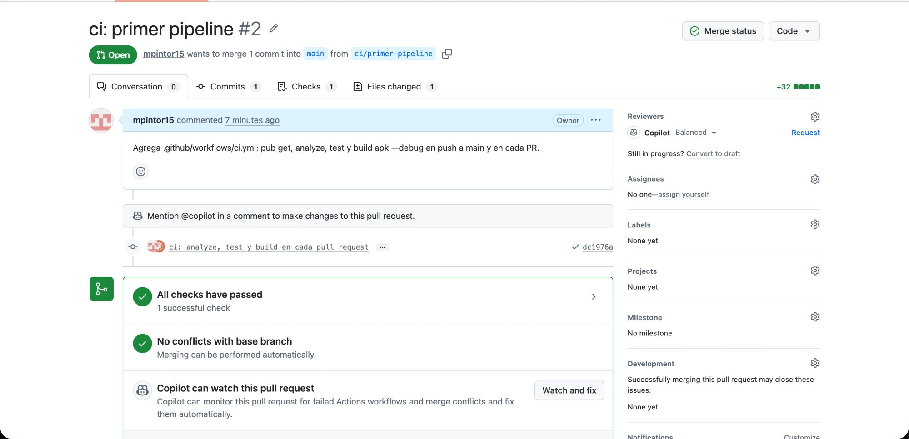
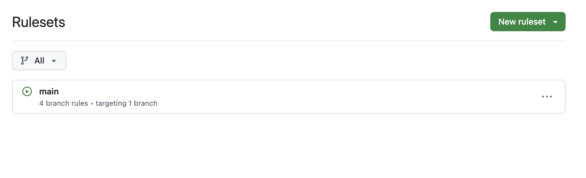
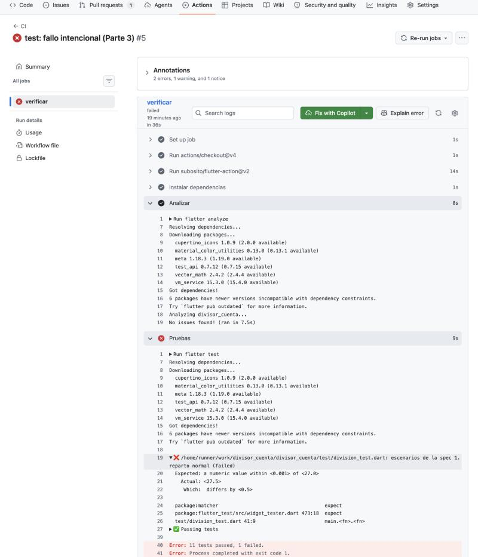
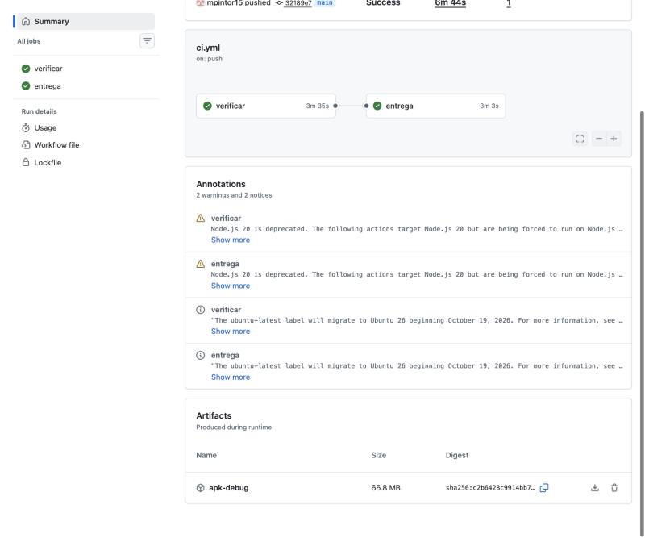
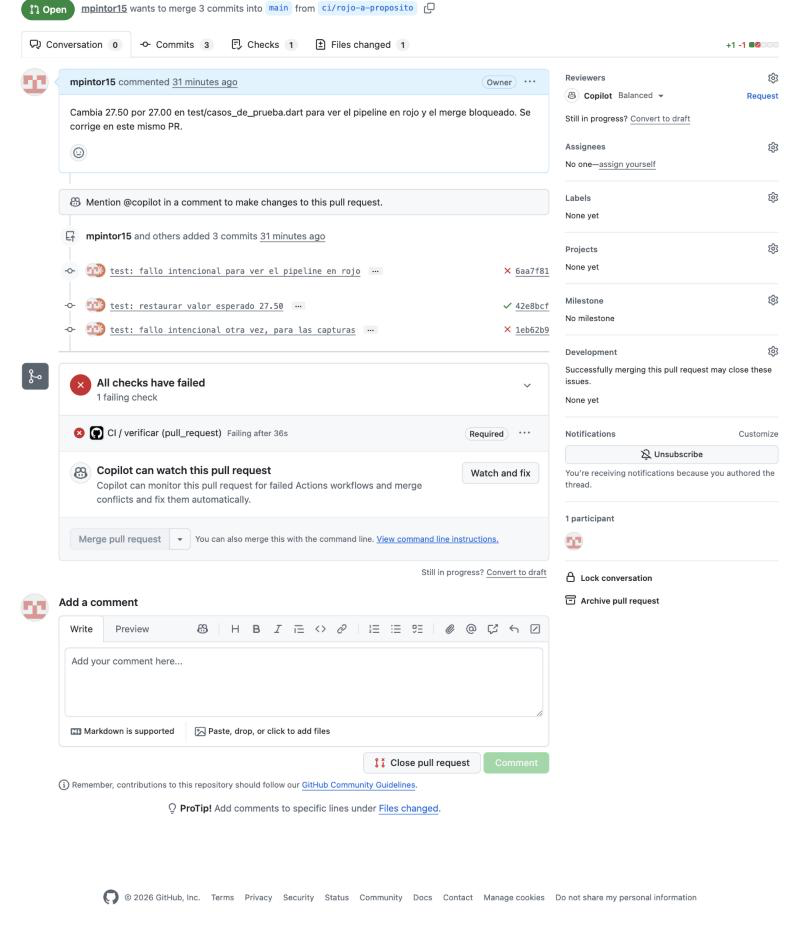
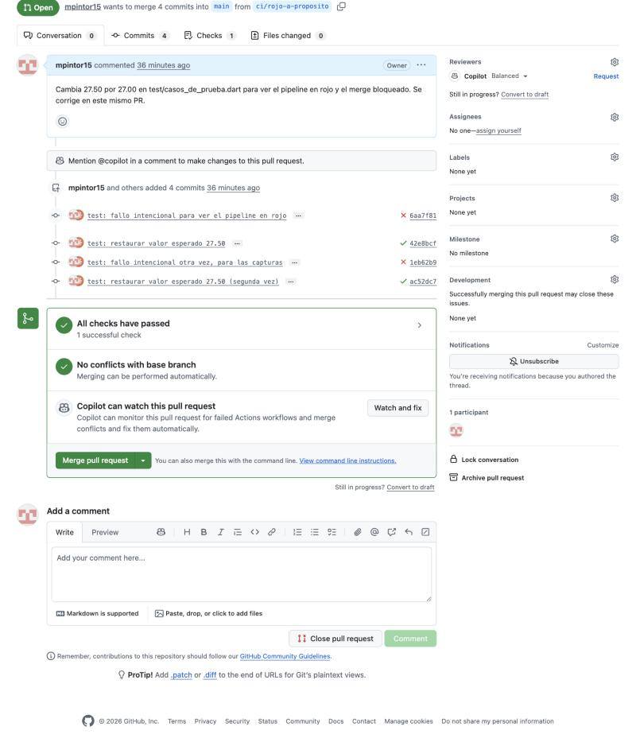

# Respuestas — Deber 4: de TDD a CI/CD

Repositorio: https://github.com/mpintor15/divisor_cuenta

Pull requests del deber: [#2 primer pipeline](https://github.com/mpintor15/divisor_cuenta/pull/2),
[#3 rojo a propósito](https://github.com/mpintor15/divisor_cuenta/pull/3),
[#4 entrega del APK](https://github.com/mpintor15/divisor_cuenta/pull/4).

## 1. Mi `ci.yml`

```yaml
name: CI

on:
  push:
    branches: [main]
  pull_request:

permissions:
  contents: read

jobs:
  verificar:
    runs-on: ubuntu-latest
    timeout-minutes: 15
    steps:
      - uses: actions/checkout@v4

      - uses: subosito/flutter-action@v2
        with:
          channel: stable
          flutter-version: 3.47.1
          cache: true

      - name: Instalar dependencias
        run: flutter pub get

      - name: Analizar
        run: flutter analyze

      - name: Pruebas
        run: flutter test

      - name: Compilar APK
        run: flutter build apk --debug

  entrega:
    needs: verificar
    if: github.event_name == 'push' && github.ref == 'refs/heads/main'
    runs-on: ubuntu-latest
    timeout-minutes: 15
    steps:
      - uses: actions/checkout@v4

      - uses: subosito/flutter-action@v2
        with:
          channel: stable
          flutter-version: 3.47.1
          cache: true

      - name: Compilar APK
        run: flutter build apk --debug

      - name: Publicar APK como artifact
        uses: actions/upload-artifact@v4
        with:
          name: apk-debug
          path: build/app/outputs/flutter-apk/app-debug.apk
          if-no-files-found: error
```

- **`analyze`:** revisa el código sin ejecutarlo y avisa de errores, variables sin uso y problemas de estilo.
- **`test`:** ejecuta las 12 pruebas automáticas y falla si alguna no da el resultado esperado.
- **`build`:** compila la app a un APK de depuración para comprobar que realmente se puede construir.

Evidencia del pipeline en verde: 

Protección de `main` (PR obligatorio y check `verificar` requerido):


## 2. El ✗ de la Parte 3



La línea que me dijo qué falló fue:

```text
Expected: a numeric value within <0.001> of <27.0>
  Actual: <27.5>
test/division_test.dart 41:9
```

Dice qué valor esperaba la prueba (27.0, el que cambié a propósito), qué calculó la app (27.5) y en qué
archivo y línea falló. Además, el resumen decía «11 tests passed, 1 failed», así que sé que solo falló el
escenario «1. reparto normal».

## 3. CI, entrega continua y despliegue continuo

- **Integración continua (CI):** cada cambio se compila y se prueba automáticamente en una máquina limpia,
  para detectar pronto los errores de integrar el código.
- **Entrega continua (continuous delivery):** además, cada cambio que pasa deja un artefacto listo para
  publicar, pero una persona decide cuándo hacerlo.
- **Despliegue continuo (continuous deployment):** lo que pasa las pruebas llega a producción solo, sin
  aprobación humana.

Implementé CI (el job `verificar`) y una **introducción a la entrega continua** (el job `entrega`, que
genera y guarda el APK como artifact solo cuando CI pasó en `main`). No es despliegue continuo: no se
publica nada a usuarios, y el APK es de depuración, sin firmar, así que no está listo para producción.

Artifact generado: 

## 4. El merge bloqueado



Con el check `verificar` fallando, el botón de merge quedó deshabilitado. Eso evita que un cambio que rompe
las pruebas llegue a `main`, y así `main` siempre tiene código que compila y pasa las pruebas. Después de
corregir en el mismo PR, el pipeline volvió a ✓ y el merge se habilitó:


## 5. Revisión crítica del agente (Parte 5)

Le pedí al agente que revisara mi `ci.yml` y señaló estos puntos. Apliqué las dos que acepté en el
[PR #5](https://github.com/mpintor15/divisor_cuenta/pull/5) y el pipeline siguió en verde:

| Sugerencia | Decisión | Por qué |
|---|---|---|
| Fijar `flutter-version: 3.47.1` en vez de `channel: stable` | Aceptada | Así el build no cambia cuando sale una nueva versión de Flutter sin que yo toque el código. |
| Agregar `timeout-minutes: 15` | Aceptada | Evita que un run colgado gaste minutos. |
| Fijar `subosito/flutter-action` a un hash de commit | Rechazada | Es lo más seguro con una acción de un tercero, pero exige buscar el hash yo mismo; en un proyecto real lo haría. |
| Subir el APK en `verificar` y descargarlo en `entrega` | Rechazada | Evita compilar dos veces, pero añade complejidad que este deber no necesita. |

Ninguna sugerencia agregó paquetes o acciones nuevas: todas usan lo que el workflow ya tiene, así que no
hubo nada nuevo que verificar.

## 6. Qué garantiza un CI verde

Garantiza que, en una máquina limpia, el código **analiza sin avisos, pasa las pruebas que existen y
compila**. Nada más. No garantiza que la app esté bien, solo que cumple lo que las pruebas comprueban.

Pueden quedar sin detectar: reglas de negocio sin prueba, pruebas mal escritas, problemas de interfaz en
un teléfono real, fallos del build de *release* o de la firma, y errores de rendimiento.

**Ejemplo:** si cambio el límite de propina de 100 a 200 y borro la prueba que protege ese límite, el
pipeline sigue en verde aunque la regla ya sea otra. Otro: el APK de depuración compila, pero el de
*release* podría fallar por la firma, y CI no lo vería.

## 7. Qué detectó el pipeline que yo no había visto

El pipeline me dejó ver el fallo con claridad: cuando cambié 27.50 por 27.00, el log me indicó el archivo,
la línea (`division_test.dart 41:9`) y el valor esperado y el real, sin que yo tuviera que correr nada.
También me mostró avisos que no veía en local: que `actions/checkout` y `actions/upload-artifact` usan
Node 20, que está obsoleto, y que `ubuntu-latest` migrará a Ubuntu 26.
